# pfSense-Firewall-SecurityLab
Built a virtual cybersecurity lab using pfSense and Ubuntu to configure firewall rules, troubleshoot DNS resolution, analyze blocked network traffic, and verify connectivity.
# pfSense Firewall & DNS Troubleshooting Homelab

## Project Overview

Built a virtual network security homelab using **pfSense CE 2.9.0, Ubuntu Linux, and Oracle VirtualBox** to gain hands-on experience with firewall administration, network configuration, DNS troubleshooting, traffic filtering, and firewall log analysis.

The project involved configuring an isolated network, troubleshooting a DNS access-control issue, implementing a targeted firewall rule, and verifying network behavior through command-line testing and firewall logs.

Rather than simply configuring services, I focused on identifying problems, investigating potential causes, applying corrections, and validating the results.

## Lab Environment

| Component | Configuration |
|---|---|
| Hypervisor | Oracle VirtualBox |
| Firewall | pfSense CE 2.9.0 |
| Client Operating System | Ubuntu Linux |
| WAN Interface | em0 |
| WAN Address | 10.0.2.15/24 |
| LAN Interface | em1 |
| LAN Gateway | 192.168.50.1/24 |
| Ubuntu Client | 192.168.50.100/24 |
| DHCP Range | 192.168.50.100–192.168.50.200 |
| Internal Network | SecurityLab |
| DNS Resolver | Unbound |

### Network Topology

Internet → VirtualBox NAT → pfSense Firewall → SecurityLab → Ubuntu Client

The pfSense virtual machine uses two network interfaces:

- **WAN:** Connects to the VirtualBox NAT network for external connectivity.
- **LAN:** Connects to an isolated internal network named SecurityLab.

Ubuntu communicates through the pfSense LAN interface, allowing pfSense to manage routing, DNS, and firewall policies.

---

## Part 1 — Network Configuration & Connectivity

### Step 1 — Configure pfSense Network Interfaces

Installed pfSense CE 2.9.0 in VirtualBox and configured its WAN and LAN interfaces.

**WAN Configuration:**
- Interface: em0
- Address: 10.0.2.15/24
- Address assignment: DHCP through VirtualBox NAT

**LAN Configuration:**
- Interface: em1
- Address: 192.168.50.1/24
- Network: 192.168.50.0/24

Enabled DHCP on the LAN interface using an address pool of 192.168.50.100–192.168.50.200.

**Result:** pfSense successfully initialized both interfaces.

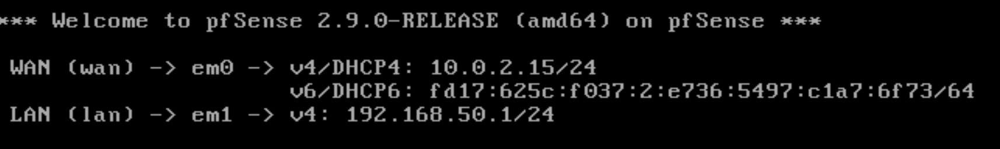

### Step 2 — Verify Ubuntu Connectivity to pfSense

Connected the Ubuntu VM to the SecurityLab internal network.

Ubuntu received the IPv4 address `192.168.50.100/24`.

Tested connectivity to the pfSense LAN gateway using:

`ping -c 4 192.168.50.1`

**Result:**
- 4 packets transmitted
- 4 packets received
- 0% packet loss

This confirmed that Ubuntu could successfully communicate with the pfSense LAN interface.

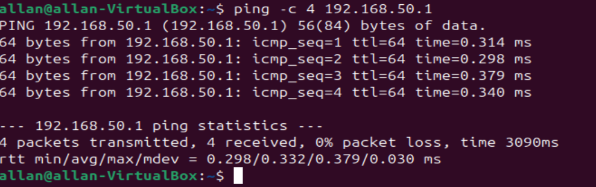

### Step 3 — Verify the Routing Table

Used the Linux routing command:

`ip route`

The output confirmed:

`default via 192.168.50.1 dev enp0s3 proto dhcp src 192.168.50.100`

**Findings:**
- Ubuntu's default gateway was 192.168.50.1.
- Traffic used the enp0s3 interface.
- The default route was configured through DHCP.
- Ubuntu was connected to the 192.168.50.0/24 network.

This verified that Ubuntu was configured to route traffic for external networks through pfSense.

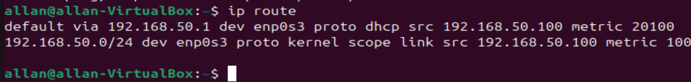

### Step 4 — Verify Internet Connectivity

Tested external IP connectivity from Ubuntu:

`ping -c 4 1.1.1.1`

**Result:**
- 4 packets transmitted
- 4 packets received
- 0% packet loss

This confirmed that Ubuntu could communicate with an external IPv4 address through the pfSense network configuration.

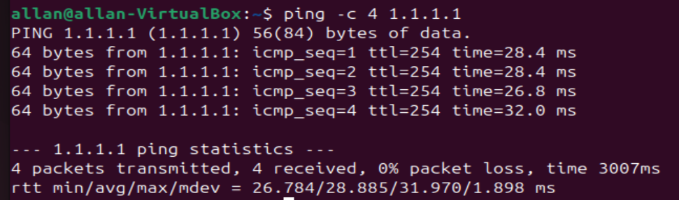

---

## Part 2 — DNS Troubleshooting

### Problem Description

Although Ubuntu could reach external IP addresses, it could not resolve domain names.

This suggested that basic IP connectivity was functioning, but DNS resolution was experiencing a separate problem.

### Step 5 — Identify DNS Resolution Failure

Executed:

`nslookup google.com`

**Result:**

`SERVFAIL`

The request was handled by Ubuntu's local DNS stub resolver at `127.0.0.53`, but name resolution failed.

This demonstrated that successful internet connectivity does not necessarily mean DNS is functioning correctly.

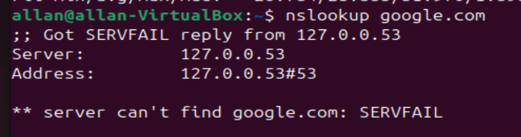

### Step 6 — Test pfSense DNS Directly

Checked Ubuntu's DNS configuration using:

`resolvectl status`

The configured DNS server was:

`192.168.50.1`

Next, queried pfSense directly:

`nslookup google.com 192.168.50.1`

**Result:**

`REFUSED`

This response indicated that the DNS server was reachable but refused to process the query.

The investigation shifted toward pfSense's DNS Resolver configuration.

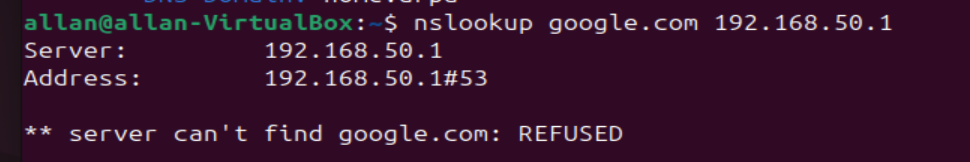

### Step 7 — Verify the Local DNS Resolver

Accessed the pfSense shell and investigated the Unbound DNS Resolver service.

Confirmed that Unbound was listening on DNS port 53 using:

`sockstat -4 -l | grep ':53'`

Then tested DNS resolution through localhost:

`drill @127.0.0.1 google.com`

**Result:**
- Response code: NOERROR
- Answer count: 1
- DNS resolution successful

This established that Unbound was capable of resolving external domain names locally.

Since DNS worked through localhost but was refused through the LAN interface, I continued investigating how the resolver handled requests from different addresses.

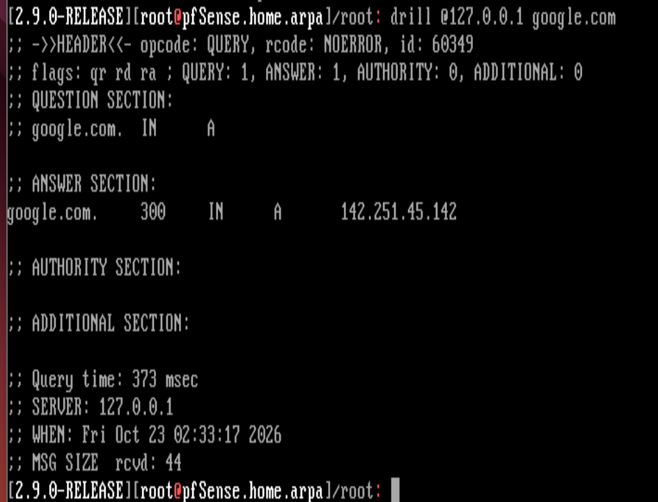

### Step 8 — Investigate Unbound Access Controls

Inspected the generated Unbound access-control configuration:

`cat /var/unbound/access_lists.conf`

The configuration contained rules allowing localhost traffic, including:

- 127.0.0.1/32
- 127.0.0.0/8
- ::1
- ::1/128

However, the SecurityLab subnet `192.168.50.0/24` was not explicitly included.

**Finding:** The missing LAN permission was consistent with the REFUSED responses received when querying pfSense from Ubuntu.

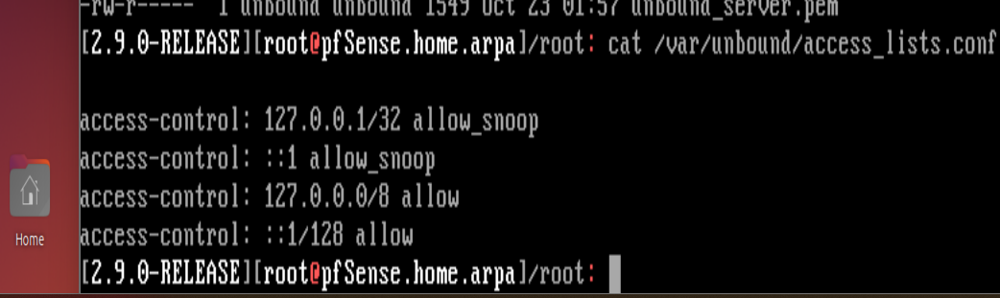

### Step 9 — Correct DNS Access Control

Opened the pfSense web interface and navigated to:

**Services → DNS Resolver → Access Lists**

Created the following rule:

| Setting | Configuration |
|---|---|
| Access List Name | SecurityLab |
| Action | Allow |
| Network | 192.168.50.0/24 |
| Description | Allow DNS queries from SecurityLab |

Saved the rule and applied the configuration changes.

This permitted DNS queries originating from the SecurityLab subnet.

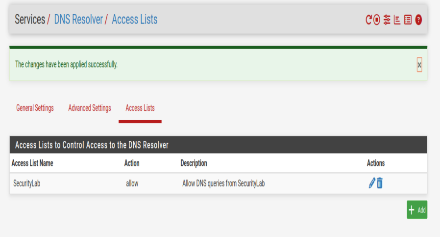

### Step 10 — Verify DNS Resolution

Returned to Ubuntu and repeated the DNS lookup:

`nslookup google.com`

**Result:** Successful.

The command returned both IPv4 and IPv6 DNS records for google.com.

This confirmed that domain-name resolution was functioning after updating the Unbound access-control configuration.

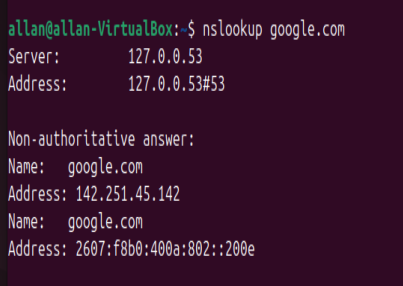

### DNS Troubleshooting Outcome

The issue was resolved by allowing DNS queries from the SecurityLab subnet through Unbound.

The investigation demonstrated the importance of distinguishing between network connectivity, DNS service availability, and DNS access-control permissions.

---

## Part 3 — Firewall Rule Configuration

### Objective

Configure a targeted firewall rule to block ICMP traffic from Ubuntu to a specific external IPv4 address, without unnecessarily restricting other network traffic.

### Step 11 — Review Existing Firewall Rules

Navigated to:

**Firewall → Rules → LAN**

Reviewed the existing rules:

- Anti-Lockout Rule
- Default Allow LAN IPv4
- Default Allow LAN IPv6

The default IPv4 allow rule permitted outbound traffic from the LAN.

**Important concept:** pfSense evaluates interface firewall rules in order, generally using the first matching rule.

Therefore, a specific block rule must be positioned above the default allow rule to take effect.

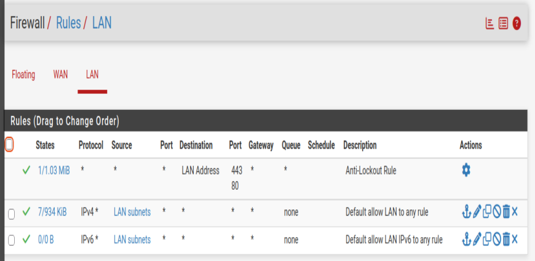

### Step 12 — Create an ICMP Block Rule

Created a custom rule with these settings:

| Setting | Configuration |
|---|---|
| Action | Block |
| Interface | LAN |
| Address Family | IPv4 |
| Protocol | ICMP |
| Source | 192.168.50.100 |
| Destination | 1.1.1.1 |
| Logging | Enabled |
| Description | Block Ubuntu ICMP to 1.1.1.1 |

Placed the new rule above the default IPv4 allow rule.

**Purpose:** Block ICMP traffic from the Ubuntu client to the selected destination while leaving unrelated traffic governed by the existing firewall rules.

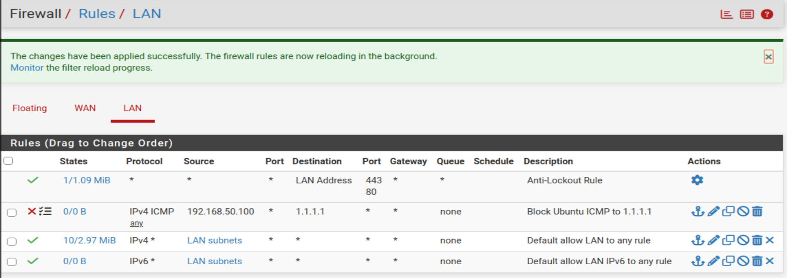

---

## Part 4 — Firewall Testing & Log Analysis

### Step 13 — Test the ICMP Block Rule

After applying the firewall configuration, returned to Ubuntu and executed:

`ping -c 4 1.1.1.1`

**Results:**
- 4 packets transmitted
- 0 packets received
- 100% packet loss

Before enabling the block rule, this same connectivity test returned 0% packet loss.

The new result was consistent with the intended firewall restriction.

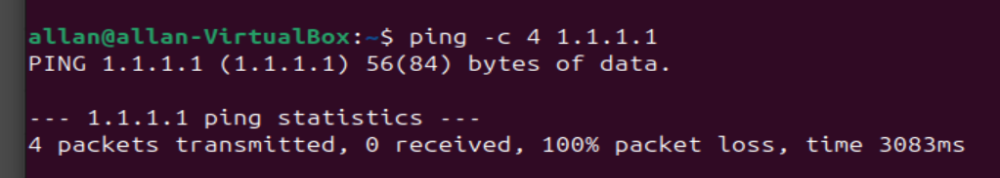

### Step 14 — Analyze Firewall Logs

Navigated to:

**Status → System Logs → Firewall**

Located entries corresponding to the blocked ping requests.

| Log Field | Observed Value |
|---|---|
| Action | Block |
| Interface | LAN |
| Source | 192.168.50.100 |
| Destination | 1.1.1.1 |
| Protocol | ICMP |
| Matching Rule | Block Ubuntu ICMP to 1.1.1.1 |
| Matching Entries | 4 |

The firewall logs confirmed that the custom rule blocked four ICMP requests from Ubuntu.

This provided evidence that the failed ping test was caused by the configured firewall policy rather than a general network connectivity issue.

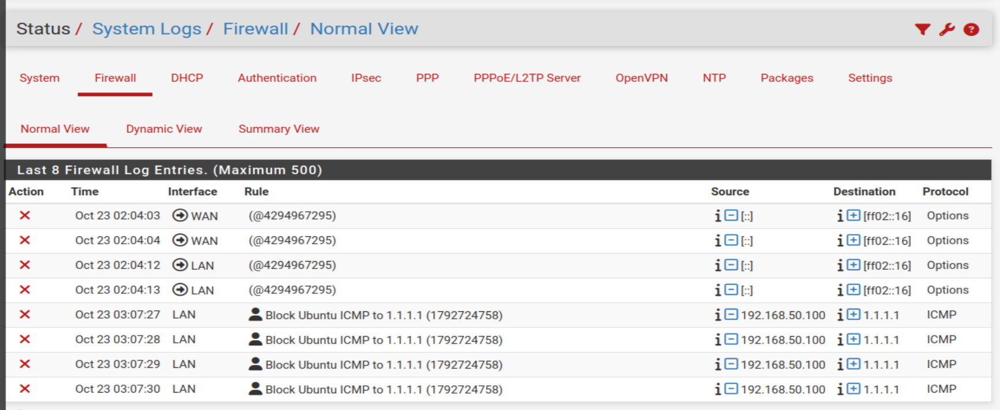

---

## Part 5 — Restore Network Connectivity

### Step 15 — Disable the Firewall Rule and Verify

Returned to:

**Firewall → Rules → LAN**

Disabled the custom ICMP block rule and applied the changes.

The rule was retained in a disabled state for future testing.

Repeated the connectivity test from Ubuntu:

`ping -c 4 1.1.1.1`

**Results:**
- 4 packets transmitted
- 4 packets received
- 0% packet loss

This confirmed that ICMP connectivity was restored after disabling the block rule.

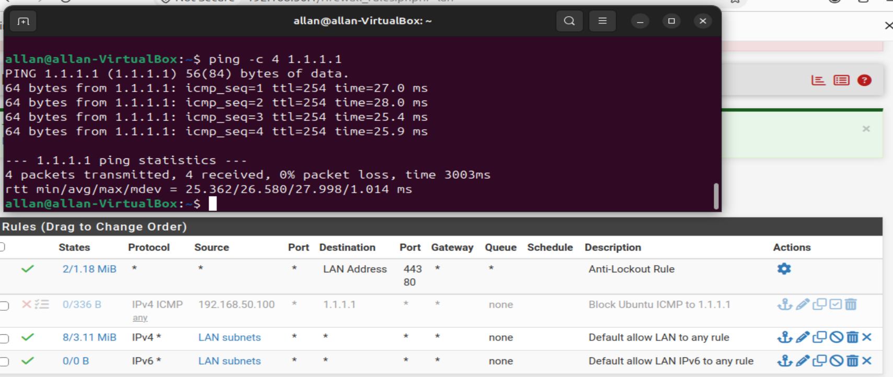

---

## Testing Summary

| Test | Expected Outcome | Actual Result |
|---|---|---|
| Ubuntu to pfSense LAN | Successful connectivity | Passed |
| Ubuntu default gateway | 192.168.50.1 | Verified |
| External IPv4 connectivity | Ping succeeds | Passed |
| Initial DNS lookup | Resolve domain name | Failed — SERVFAIL |
| Direct query to pfSense | DNS answer | REFUSED |
| Local Unbound lookup | Successful response | Passed |
| DNS after access-list change | Successful lookup | Passed |
| ICMP block rule enabled | Ping blocked | 100% packet loss |
| Firewall log verification | Matching blocked traffic | 4 entries confirmed |
| ICMP block rule disabled | Connectivity restored | 0% packet loss |

## Skills Demonstrated

**Firewall Administration**
- pfSense installation and interface assignment
- Firewall rule creation and ordering
- IPv4 and ICMP traffic filtering
- Firewall logging and rule verification

**Network Administration**
- VirtualBox NAT and internal networking
- IPv4 addressing and subnetting
- DHCP configuration
- Default gateway and routing verification

**DNS Troubleshooting**
- Unbound DNS Resolver administration
- DNS access-control configuration
- DNS queries using nslookup and drill
- Differentiating SERVFAIL, REFUSED, and successful responses

**Linux & Troubleshooting Tools**
- ping
- ip route
- resolvectl
- nslookup
- drill
- sockstat
- grep
- cat

## Key Takeaways

This project helped me develop a better understanding of how network routing, DNS, and firewall policies interact.

I learned to investigate network issues systematically by testing individual components rather than assuming that all connectivity problems share the same cause.

The DNS troubleshooting exercise demonstrated how a service can function locally while refusing requests from network clients.

The firewall exercise reinforced the importance of rule ordering, traffic filtering, and log analysis. By creating a block rule, confirming matching events in the firewall logs, and safely restoring connectivity, I gained practical experience managing firewall policies.

**The most valuable lesson was learning to verify the cause of a problem through evidence, apply a targeted correction, and confirm the result with repeatable testing.**

---

## Future Improvements

Potential extensions to this homelab include:

- Integrating Kali Linux as an additional isolated test client
- Capturing and analyzing network traffic using Wireshark
- Practicing additional firewall rules for TCP and UDP services
- Configuring network segmentation with multiple LAN interfaces
- Investigating firewall states and connection logs
- Exploring intrusion detection and prevention in an isolated environment

These exercises will build on the existing pfSense configuration and develop additional practical networking and security administration skills.
